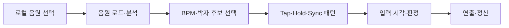

# Rhythm — Audio-Driven Rhythm Tech Demo

사용자가 선택한 음원을 분석하고, 박자 후보를 선택해 Tap·Hold·Sync 리듬 작업으로 연결하는 Unity 기술 데모입니다. 기존 RhythmDefense 작업물의 리듬·오디오 구현을 바탕으로, 현재는 **Boot 씬의 독립적인 실행 흐름**을 다듬고 있습니다.

포트폴리오용으로 개발 중인 프로토타입입니다. 배포용 게임·완성된 독립 제품으로 공개한 상태는 아닙니다.

## 살펴볼 구현

| 영역 | 구현 내용 | 주요 위치 |
|---|---|---|
| 음원 로드 | 로컬 WAV·OGG·MP3 선택, 로드 실패와 재시도 처리 | `Assets/Scripts/Audio/LocalMusicLoader.cs` |
| 음악 분석 | 구간 분석, 스펙트럴 플럭스, BPM 주기성·후보 종합, 박자 위상 계산 | `Assets/Scripts/Audio/Analysis/` |
| 리듬 패턴 | 후보·프레이즈 선택, Tap·Hold·Sync 생성, 음원 기반 Hold 구간 평가 | `Assets/Scripts/Rhythm/` |
| 재생·판정 | DSP 기반 곡 시간, 입력 시각 변환, Perfect·Good·Normal·Miss 판정 | `MusicPlayback.cs`, `RhythmInputTester.cs` |
| 표현·결과 | 박자 안내, 나무·도끼 동작, 판정 피드백, 작업 결과 정산 | `Assets/Scripts/Forest/` |

위 표는 코드에 포함된 구현을 설명합니다. BPM 정확도, 오디오 지연, 전체 곡 안정성이나 성능을 벤치마크한 결과를 뜻하지 않습니다.

## 실행 방법

1. 이 저장소를 내려받아 Unity Hub에서 프로젝트 폴더를 엽니다.
2. Unity **`6000.5.10f1`**을 사용하고 패키지 복원·임포트가 끝날 때까지 기다립니다.
3. `Assets/Scenes/Boot.unity`를 열고 Play를 실행합니다.
4. **파일 선택**으로 사용할 WAV·OGG·MP3를 선택하고 **불러오기**를 누릅니다.
5. 분석이 끝나면 박자 후보를 확인하고 시작 버튼을 누릅니다. 플레이 중에는 Game 창에 포커스를 유지합니다.

| 입력 | 동작 |
|---|---|
| 왼쪽 마우스 | 왼쪽 Tap·Hold |
| 오른쪽 마우스 | 오른쪽 Tap·Hold |
| Space | 양쪽 동시 Sync |
| Hold | 해당 입력을 누른 채 유지하고 종료 시점에 해제 |

**시험용 음원은 공개 저장소에 포함하지 않습니다.** 실행 시 본인이 사용할 수 있는 음원을 선택해 주세요. 로컬 개발 환경의 기본 경로가 입력창에 표시되더라도 파일 선택으로 바꿀 수 있습니다.

## 개발 환경

- Unity `6000.5.10f1` / C# / Windows Editor
- Universal Render Pipeline `17.6.0`
- Input System `1.20.0`, uGUI·TextMeshPro `2.5.0`
- 의존성 기준: `Packages/manifest.json`, `Packages/packages-lock.json`

## 현재 범위와 검증

- 현재 개발 범위는 **Boot와 그 실행 의존성**입니다. 캠프·전투·캠페인 코드는 기존 참조를 보존하기 위해 남아 있으며, 이번 기술 데모의 개발 범위를 뜻하지 않습니다.
- TMP 필수 리소스·셰이더 include 누락과 기본 음원 경로 문제를 수정했습니다. 이후 사용자가 Boot 정상 작동을 확인했습니다.
- 상세 자동 입력·완주·성능 검증은 완료되지 않았습니다. 에이전트의 수정 후 Play 재검증은 자동화·라이선스 연결 제한으로 미수행이며, 사용자 확인과 구분해 기록했습니다.
- 독립 프로젝트 분리 방식, 최종 콘텐츠, 배포 빌드는 추후 기획할 예정입니다.

자세한 근거와 한계는 [Boot 수정·검증 결과](검증결과/BootFixVerification.md)를 참고해 주세요. 기존 실행 이미지는 수정 전 진단 자료이며 현재 데모의 대표 화면으로 사용하지 않습니다.

## 프로젝트·문서 구조

| 폴더 | 내용 |
|---|---|
| `Assets` | 씬, C# 코드, UI·연출 에셋과 외부 리소스 |
| `Packages`, `ProjectSettings` | Unity 의존성·실행 설정 |
| [작업관리](작업관리/README.md) | Boot 범위·목표, 폴더 관리와 공개 저장소 운영 기준 |
| [검증결과](검증결과/README.md) | 결함 진단·수정 검증과 과거 실행 화면 |
| [변경기록](변경기록/README.md) | 날짜별 변경 이력 |
| [참고자료](참고자료/README.md) | 외부 리소스 고지·라이선스와 로컬 참고 기록 |

문서용 분류 폴더는 한글, 파일명은 영문을 사용하고 각 폴더의 `README.md`에서 목록을 관리합니다. Unity의 기존 코드·에셋 경로는 참조를 보존하기 위해 유지합니다.

## 외부 리소스

폰트·TMP 리소스 등 외부 자료의 출처와 라이선스는 [ThirdPartyNotices.md](참고자료/ThirdPartyNotices.md)에 기록했습니다. 프로젝트 자체의 별도 오픈소스 라이선스는 아직 지정하지 않았습니다.
